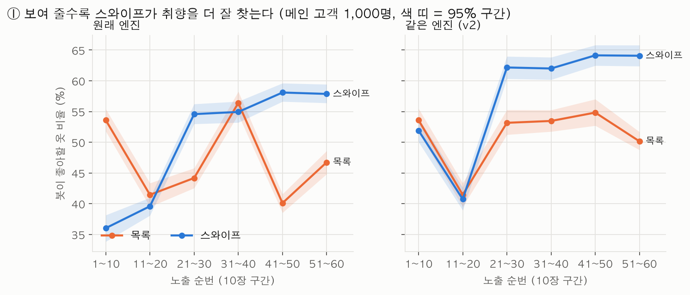
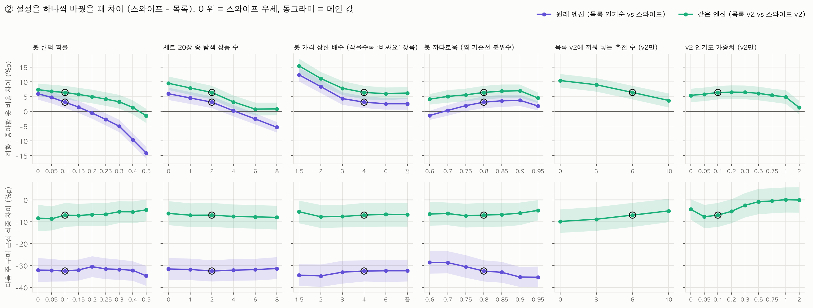
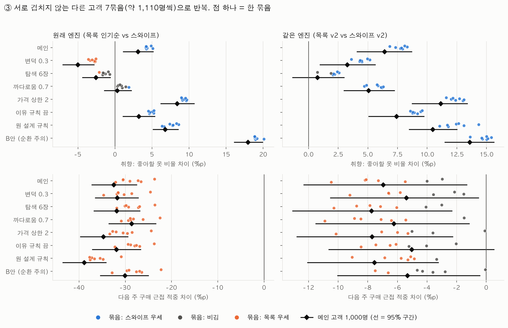
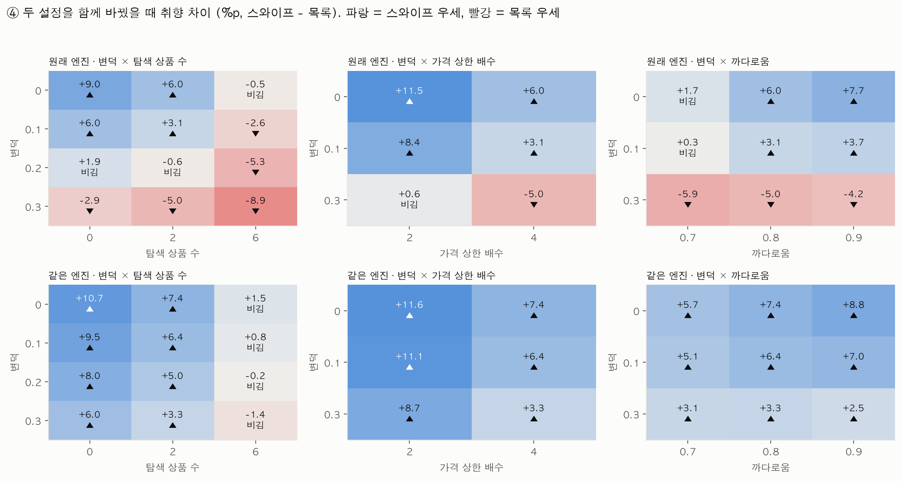
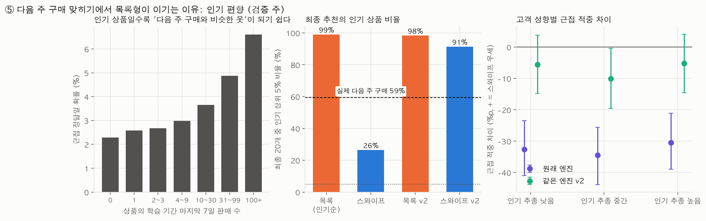
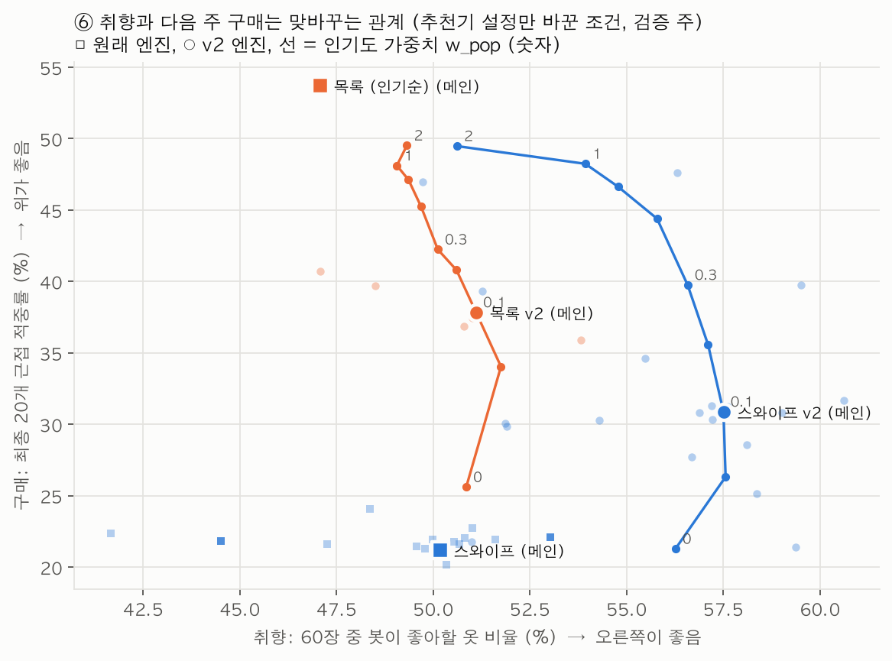
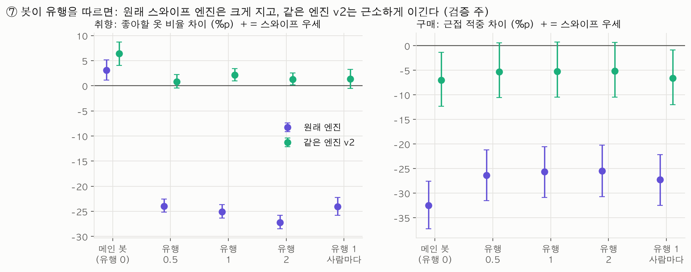

# 목록형 vs 스와이프형 쇼핑몰: 숨은 취향을 누가 더 잘 찾나

실제 H&M 고객의 구매 기록으로 가상 고객(봇)을 만들어, **목록형 쇼핑몰**과 **스와이프형 쇼핑몰(대추마켓)** 중 어느 쪽이 고객의 숨은 옷 취향을 더 빨리, 더 정확히 찾는지 비교한 시뮬레이션 실험입니다.
봇은 상품 **사진**(FashionCLIP)을 보고 찜하거나 넘기고, 넘길 때 이유(취향 아님 · 비싸요 · 이미 있어요)를 말합니다.

> 메인 결과는 **정답 주**(2020-09-16 ~ 09-22)로 한 번만 채점했습니다. 135개 조건 비교는 **검증 주**(09-09 ~ 09-15) 기준입니다.

## 결과 요약

| | 원래 엔진 (목록 인기순 vs 스와이프) | 같은 엔진 v2 (화면 방식만 다름) |
|---|---|---|
| 60장 중 봇이 좋아할 옷 비율 | **+3.1%p** 스와이프 우세 | **+6.4%p** 스와이프 우세 |
| 최종 추천 20개 중 좋아할 옷 | 비김 | **+3.4개** 스와이프 우세 |
| 다음 주 실제 구매 근접 적중 (정답 주) | −33.6%p 목록 우세 | −13.4%p 목록 우세 |
| 조건 79개(v2)에서 취향 판정 | 41 이김 / 10 비김 / 11 짐 (62개) | **68 이김 / 11 비김 / 0 짐** |
| 다른 고객 7묶음 반복 | 7묶음 모두 스와이프 우세 | 7묶음 모두 스와이프 우세 |

- **화면 방식만 비교하면 스와이프가 취향을 더 잘 찾습니다.** 봇 설정을 바꾸거나 다른 고객 7,780명으로 바꿔도 유지됩니다.
- 원래 스와이프 엔진은 봇의 **변덕**(실수로 반대로 누름)이 0.25 이상이거나 **탐색 상품**을 6장 넘게 섞으면 집니다.
- '비싸요' 같은 **넘긴 이유 신호**가 잦을수록 스와이프가 더 유리합니다. 다만 이유 신호를 꺼도 스와이프가 이깁니다.
- **다음 주에 실제로 살 옷을 맞히는 데는 인기 상품 위주의 목록이 유리합니다.** "취향을 찾는 것"과 "다음 주 구매를 맞히는 것"은 다른 문제입니다.

**추가 분석 (2026-11-27, 검증 주, [보고서 8장](report.md#8-추가-분석-2026-11-27-검증-주만))**
- 다음 주 구매의 59%가 인기 상위 5% 상품이다. 구매 적중에서 목록형이 이기는 이유는 대부분 **인기 편향**이다.
- 같은 엔진에서 인기도 가중치를 0.3~1로 올리면 스와이프가 **취향은 이기고 구매 적중은 비긴다.**
- 봇에 **유행 따르기**를 넣으면 실제 구매 설명력이 AUC 0.725 → 0.90으로 오른다. 이 봇에서도 같은 엔진 스와이프가 근소하게 이긴다(+2.2%p, 7묶음 중 5승 2무). 인기도를 안 쓰는 원래 스와이프 엔진은 크게 진다.
- seed를 5개 → 20개로 늘려도 결과가 같다.

자세한 내용: [보고서 (report.md)](report.md) · [전체 135개 실행 결과표](data/results/all_runs_valid.md)









## 실험 설계

1. **봇.** 학습 기간(2020년 7~9월 초) 구매 기록만으로 만듭니다.
   - 취향 = 산 옷 사진 좌표의 가중 평균(반감기 14일)
   - 찜 기준선, 가격 상한(최근 14일 구매 가격 중앙값 × 4), '이미 있어요'(최근 28일에 산 옷과 거의 같은 옷)
   - 변덕 확률 0.1
   - 규칙 값은 검증 주 실제 구매로 보정했습니다.
2. **쇼핑몰.** 고객을 층화해 A/B로 배정합니다. 둘 다 60장을 보여 준 뒤 최종 추천 20개를 냅니다.
   - **목록형:** 페이지로 보여 줍니다. 넘긴 이유를 받지 못합니다.
   - **스와이프형:** 20장씩 보여 주고, 찜과 이유를 반영해 다음 세트를 고릅니다.
   - **같은 엔진(v2) 비교:** 추천 엔진을 같게 맞추고 화면 방식만 다르게 해서 따로 비교합니다.
3. **순환 구조 피하기.** 봇의 취향은 사진으로, 추천기는 설명 문장(multilingual-e5)으로 계산해 서로 다른 자를 씁니다.
4. **채점.**
   - 메인 지표: 변덕을 뺀 봇 규칙으로 판정한 취향 회복(좋아할 옷 비율, 최종 20개 중 좋아할 옷, '비싸요' 뒤 반복 노출, 첫 찜까지 장수)
   - 현실 점검: 다음 주 실제 구매 적중
   - seed 5개, 부트스트랩 95% 구간이 0을 포함하면 비김
5. **견고성.** [`experiments.yaml`](experiments.yaml)에 적은 135개 조건을 돌렸습니다.
   - 설정 하나씩 바꾸기, 여러 값 한꺼번에 바꾸기, 두 설정 조합
   - 서로 겹치지 않는 고객 7묶음으로 반복

설계 문서: [원 명세](hm_list_vs_swipe_experiment.md) → [수정 v2](spec_amendment_v2.md) → [수정 v3](spec_amendment_v3.md). 검증 주 결과를 본 뒤 바꾼 결정도 모두 적었습니다.

## 폴더 구조

```
config.yaml              메인 실험 설정
experiments.yaml         견고성 조건 목록 (135개 + 추가 15개)
configs/                 조건마다 자동 생성한 설정 (scripts/sweep.py)
src/
  prepare.py             기간 자르기, 봇 후보, 상품 풀, A/B 배정
  embed.py               설명 문장 임베딩 (multilingual-e5-small)
  embed_image.py         사진 임베딩 (FashionCLIP)
  bots.py                봇 프로필과 반응 규칙
  calibrate_bots.py      봇 규칙 보정 (검증 주만)
  simulate.py            목록형·스와이프형 세션 실행
  scoring.py             채점 (정답 주는 이 모듈에서만 읽음)
  metrics_taste.py       취향 회복 지표
scripts/
  download_hm.py, download_images.py, extract_images.py   데이터 받기
  make_bot_folds.py      고객 7묶음 나누기
  sweep.py               조건 전체 실행
  collect_results.py     결과 모으기 → data/results/all_runs_valid.md
  make_figures.py        그래프 → data/results/figures/
  analyze_popularity.py  추가 분석: 인기 편향 (fig5)
  analyze_tradeoff.py    추가 분석: 취향과 구매의 맞바꿈 (fig6)
  calibrate_pop.py       추가 분석: 유행 따르는 봇의 실제 구매 설명력
  analyze_popbots.py     추가 분석: 유행 따르는 봇 결과, seed 20개 (fig7)
tests/                   단위 테스트 (pytest)
data/results/            조건별 검증 주 요약 결과, 그래프
```

## 다시 돌리기

```bash
python -m venv .venv && .venv/bin/pip install -r requirements.txt

# 1. 데이터: Kaggle "H&M Personalized Fashion Recommendations" 대회 규칙에 동의한 뒤 받기
#    (~/.kaggle/kaggle.json 필요, 자세한 방법은 hm_download_csv.md)
.venv/bin/python scripts/download_hm.py
.venv/bin/python scripts/extract_images.py      # 상품 풀 사진만 꺼냄

# 2. 준비
.venv/bin/python -m src.prepare
.venv/bin/python -m src.embed
.venv/bin/python -m src.embed_image
.venv/bin/python -m src.bots

# 3. 메인 실험 (검증 주)
.venv/bin/python -m src.simulate
.venv/bin/python -m src.scoring score --split valid

# 4. 견고성 조건 전체 + 정리
.venv/bin/python scripts/make_bot_folds.py
.venv/bin/python scripts/sweep.py --jobs 4      # 조건 하나 ≈ CPU 1개, 메모리 1.3GB
.venv/bin/python scripts/make_figures.py

.venv/bin/python -m pytest -q
```

## 데이터

- [H&M Personalized Fashion Recommendations](https://www.kaggle.com/competitions/h-and-m-personalized-fashion-recommendations) (Kaggle)
- 대회 데이터는 비상업·연구용이며 사진도 같은 조건입니다.
- 이 저장소에는 원본 데이터, 사진, 고객 ID가 든 파일을 올리지 않았습니다. 데이터는 각자 대회 규칙에 동의한 뒤 받아 주세요.

## 라이선스

코드와 문서는 [MIT 라이선스](LICENSE)입니다. H&M 대회 데이터(사진 포함)는 이 라이선스에 포함되지 않으며, Kaggle 대회 규칙(비상업·연구용)을 따릅니다.

## 한계

- 봇은 규칙으로 만든 가상 고객입니다. 큰 사진에 몰입하는 느낌 같은 사람의 체감은 재지 못합니다.
- FashionCLIP은 명품 패션 데이터로 학습해서, H&M 상품을 완벽히 구분하지는 못할 수 있습니다.
- 봇 규칙과 v2 인기도 가중치는 검증 주 결과를 보고 정했습니다(명세 수정 v3에 기록).
