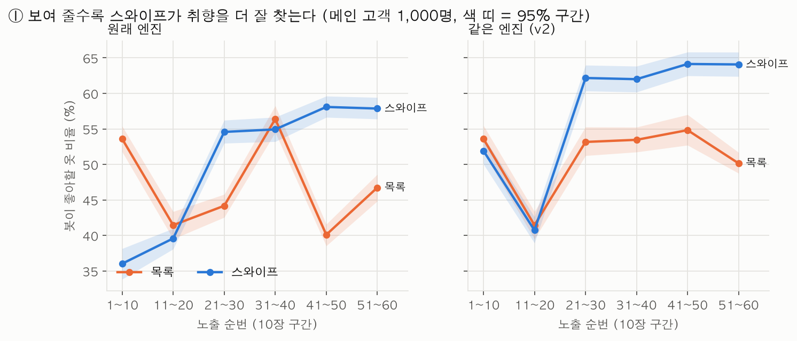
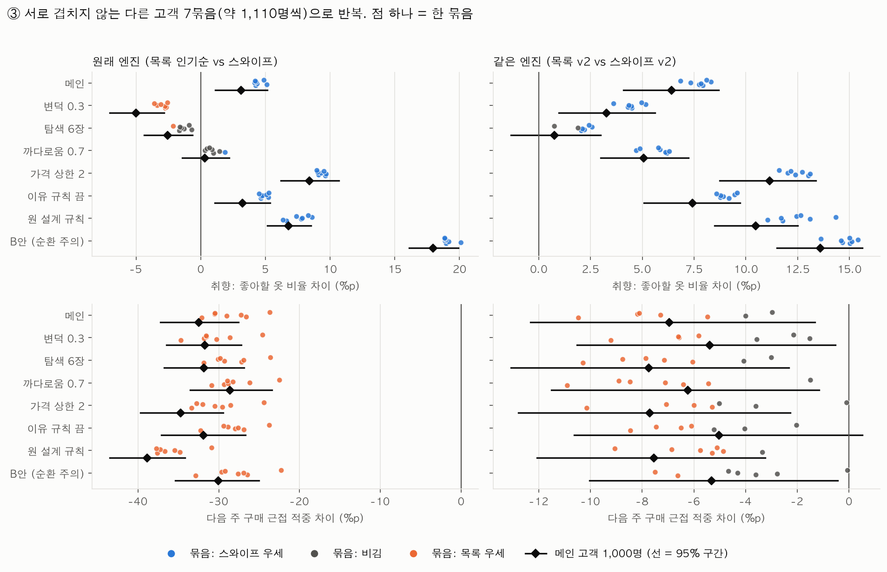
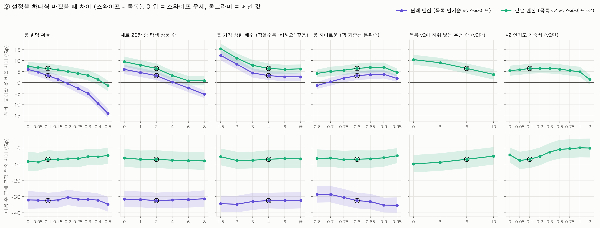
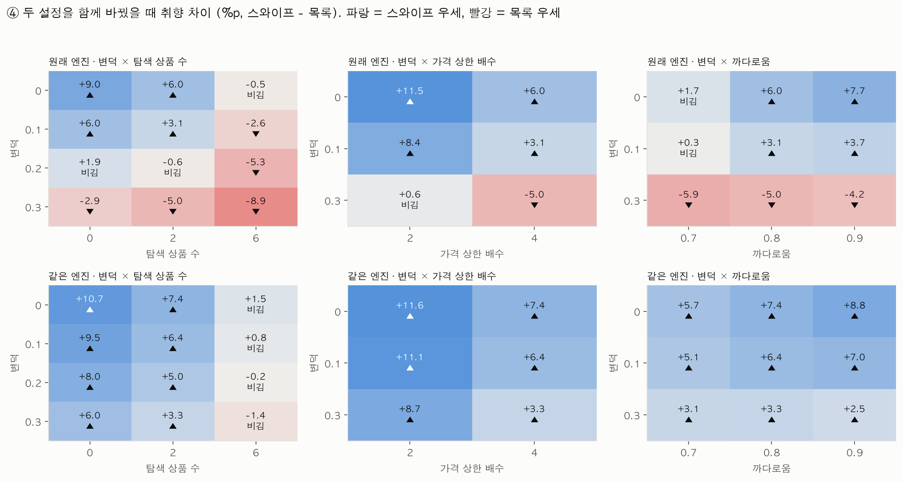

# 목록형 쇼핑몰 vs 스와이프형(대추마켓): 숨은 취향을 누가 더 잘 찾나

작성: 2026-11-26 · 데이터: H&M Kaggle (비상업·연구용, 사진 포함) · **모든 결과는 검증 주(9/9~9/15) 기준. 정답 주는 아직 열지 않음.**
자세한 표: `data/results/all_runs_valid.md` · 그래프: `data/results/figures/` · 다시 만들기: `scripts/sweep.py` → `scripts/collect_results.py` → `scripts/make_figures.py`

---

## 한 줄 결론

**같은 추천 엔진을 쓰면, 스와이프형이 봇의 숨은 취향을 더 잘 찾는다.** 79개 조건 중 68개에서 이기고 진 조건은 0개였다.
다른 고객 7묶음에서도 7번 모두 이겼다. 다만 **다음 주에 실제로 살 옷을 맞히는 데는 목록형(인기 상품 위주)이 계속 유리**하다.

---

## 1. 실험 흐름 (간단히)

1. **봇 만들기.**
   - 실제 H&M 고객 1,000명의 구매 기록으로 봇을 만든다.
   - 봇의 취향은 산 옷 **사진**(FashionCLIP)의 평균이다.
   - 봇은 옷 사진을 보고 찜하거나 넘긴다. 넘길 때 이유(취향 아님 / 비싸요 / 이미 있어요)를 말한다.
   - 가끔은 실수로 반대로 누른다(변덕).
2. **두 쇼핑몰에 보내기.** 고객을 반으로 나눠 A/B로 배정한다.
   - **목록형:** 상품을 페이지 단위로 보여 준다. 넘긴 이유는 쇼핑몰에 전달되지 않는다.
   - **스와이프형:** 20장씩 보여 주고, 찜과 넘긴 이유를 반영해 다음 20장을 고른다.
   - 둘 다 60장을 보여 준 뒤 최종 추천 20개를 낸다. seed 5개로 반복한다.
3. **비교를 두 가지로 한다.**
   - **원래 엔진:** 목록(인기순) vs 스와이프. 화면 방식과 추천 엔진이 모두 다르다.
   - **같은 엔진 (v2):** 목록 v2 vs 스와이프 v2. 추천 엔진이 같고 화면 방식만 다르다. **화면 방식만의 효과는 이쪽이 더 정확하다.**
4. **채점.**
   - **메인 지표: 취향 회복.** 보여 준 상품 중 봇이 (변덕 없이) 좋아할 옷의 비율과, 최종 20개 중 좋아할 옷의 개수.
   - **현실 점검.** 다음 주에 고객이 실제로 산 옷(또는 비슷한 옷)이 최종 20개에 있는지.
   - 판정 기준: 95% 구간이 0을 포함하면 비김.
5. **조건 바꿔 가며 반복.**
   - 135개 실행: 설정을 하나씩 바꾼 조건, 여러 값을 한꺼번에 바꾼 조건, 두 설정을 함께 바꾼 조합.
   - 고객 7,780명을 서로 겹치지 않는 7묶음으로 나눠 반복.

---

## 2. 메인 결과 (메인 고객 1,000명)

| 지표 | 원래 엔진 (목록 → 스와이프) | 같은 엔진 v2 (목록 → 스와이프) |
|---|---|---|
| 60장 중 좋아할 옷 비율 | 47.1% → 50.2% (**+3.1%p**) ▲ | 51.1% → 57.5% (**+6.4%p**) ▲ |
| 최종 20개 중 좋아할 옷 | 16.7 → 16.5개 (비김) | 14.6 → 18.0개 (**+3.4개**) ▲ |
| ┗ 그중 처음 보는 옷 | 0 → 3.8개 ▲ | 1.1 → 1.8개 ▲ |
| '비싸요'라 한 뒤 또 비싼 옷을 보여 준 비율 | 20.1% → 5.7% ▲ | 19.5% → 3.5% ▲ |
| 처음 좋아할 옷이 나오기까지 | 2.2장 → 3.8장 ▼ (목록이 빠름) | 2.2장 → 2.3장 (비김) |
| 다음 주 구매 근접 적중 | 53.7% → 21.2% (**−32.5%p**) ▼ | 37.8% → 30.9% (**−7.0%p**) ▼ |
| 다음 주 구매 정확 적중 | 7.1% → 1.5% ▼ | 7.0% → 6.6% (비김) |

▲ 스와이프 우세, ▼ 목록 우세.

**그래프 읽는 법**
- 처음 10장은 아직 반응을 받기 전이다. 이 구간에서는 원래 스와이프 엔진이 목록보다 낮게 시작한다(36% vs 54%). v2는 목록과 비슷하다.
- **21장째부터** 스와이프가 반응을 반영하기 시작하면서 차이가 벌어진다. 노출 51~60장에서는 원래 엔진 +11%p, 같은 엔진 +14%p.
- 원래 엔진의 목록 선은 구간마다 크게 오르내린다(40~56%). 반응을 반영하지 않으니 비율이 올라가는 추세가 없다.

---

## 3. 결론이 얼마나 단단한가

### 3-1. 135개 실행 판정 집계 (메인 고객, 결과가 같은 조건은 한 번만 셈)

칸 = 스와이프 이김 / 비김 / 목록 이김 조건 수.

| 지표 | 원래 엔진 (62개 조건) | 같은 엔진 v2 (79개 조건) |
|---|---:|---:|
| 좋아할 옷 비율 | 41 / 10 / 11 | **68 / 11 / 0** |
| 최종 20개 중 좋아할 옷 | 8 / 32 / 22 | **78 / 0 / 1** |
| 그중 처음 보는 옷 | 62 / 0 / 0 | 71 / 2 / 6 |
| '비싸요' 등 반복 노출 (낮을수록 좋음) | 61 / 0 / 0 | 75 / 3 / 0 |
| 처음 좋아할 옷까지 장수 | 1 / 4 / 57 | 0 / 77 / 2 |
| 다음 주 구매 근접 적중 | 0 / 0 / 62 | 0 / 18 / 61 |
| 다음 주 구매 정확 적중 | 0 / 0 / 62 | 0 / 72 / 7 |

### 3-2. 다른 고객으로 반복

고객 7,780명을 서로 겹치지 않게 7묶음으로 나눴다(약 1,110명씩).

**좋아할 옷 비율 차이, 7묶음 평균:**

| 조건 | 원래 엔진 | 같은 엔진 v2 |
|---|---|---|
| 메인 | +4.5%p (7묶음 모두 이김) | +7.7%p (7묶음 모두 이김) |
| 변덕 0.3 | −3.0%p (7묶음 모두 짐) | +4.5%p (7묶음 모두 이김) |
| 탐색 상품 6장 | −1.4%p (비김 6, 짐 1) | +2.0%p (이김 5, 비김 2) |
| 까다로움 0.7 | +1.0%p (이김 1, 비김 6) | +5.7%p (7묶음 모두 이김) |
| 가격 상한 2 | +9.3%p (7묶음 모두 이김) | +12.4%p (7묶음 모두 이김) |
| 이유 규칙(비싸요·이미 있어요) 끔 | +4.9%p (7묶음 모두 이김) | +9.0%p (7묶음 모두 이김) |
| 원 설계 봇 규칙 | +7.6%p (7묶음 모두 이김) | +12.4%p (7묶음 모두 이김) |
| B안: 추천기도 사진 기준 (순환 구조) | +19.1%p | +14.8%p |

- 봇 규칙은 메인 고객 1,000명으로 맞췄다. 그런데 **다른 고객 묶음에서도 결론이 그대로**다. 묶음끼리 차이도 작다(대부분 2%p 안).
- 다음 주 구매는 원래 엔진에서 **모든 묶음**이 목록 우세다. v2는 묶음마다 목록 우세와 비김이 섞인다.

---

## 4. 무엇이 결론을 바꾸나

**결론을 뒤집을 수 있는 것: 변덕과 탐색 상품 수**
- **봇 변덕(실수로 반대로 누름).**
  - 원래 스와이프 엔진: 변덕 0.15~0.2에서 비기고, 0.25부터 진다. 0.5에서는 −14%p.
  - v2: 0.4까지 이기고, 0.5에서야 −1.5%p가 된다.
  - **스와이프는 받은 반응을 믿고 다음 상품을 고르므로, 반응이 엉터리면 손해를 본다.** v2 엔진은 이 점에서 훨씬 튼튼하다.
- **세트 중 탐색 상품 수.** 늘릴수록 차이가 줄어든다. v2 기준 탐색 0장이면 +9.5%p, 6장 이상이면 +0.8%p다.

**스와이프를 유리하게 하는 것: 넘긴 이유 신호**
- **가격 상한이 엄격할수록**('비싸요'가 잦을수록) 차이가 커진다. v2 기준 배수 4이면 +6.4%p, 2이면 +11.1%p, 1.5이면 +15.4%p다.
- 목록형은 이 이유를 전달받지 못해서 비싼 옷을 계속 보여 준다.
- 하지만 **이유 규칙을 꺼도** 스와이프가 이긴다(+4.9 / +9.0%p). 이유 신호는 장점의 일부일 뿐이고, 찜과 넘김을 바로 반영하는 것만으로도 이긴다.

**목록 쪽이 따라붙는 경우**
- 목록 v2에 개인화 추천을 끼워 넣을수록 격차가 줄어든다. 0개면 +10.4%p, 10개면 +3.7%p다.
- v2 인기도 가중치를 크게 하면(1 이상), 취향 차이는 줄고 다음 주 구매 차이는 비김이 된다.

**거의 영향 없는 것**
- 취향 반감기(3~60일), 변형 상품 수, '이미 있어요' 기준과 비교 기간, '취향 아님' 반영 세기, 가격 기준 방식

**두 가지를 함께 바꾸면**
- **변덕과 탐색은 함께 나빠진다.** 변덕 0.3에 탐색 6장이면 원래 엔진 −8.9%p, v2도 비김(−1.4%p)이다.
- **엄격한 가격 상한은 변덕을 이긴다.** 변덕 0.3이라도 가격 상한 2이면 v2가 +8.7%p다.

---

## 5. 해석

1. **화면 방식만 놓고 보면(같은 엔진) 스와이프가 취향을 더 빨리, 더 정확히 찾는다.**
   - 세트마다 반응을 바로 반영하고, 넘긴 이유까지 쓰기 때문이다.
   - 봇과 고객을 바꿔도 이 결론은 유지된다.
2. **원래 스와이프 엔진은 취약하다.** 반응에 잡음이 많거나 탐색을 많이 섞으면 인기순 목록에 진다. 실제 서비스라면 v2 쪽 엔진 설계가 낫다.
3. **"취향을 잘 찾는다"와 "다음 주에 살 옷을 맞힌다"는 다른 문제다.**
   - 다음 주 실제 구매는 인기 상품이나 재구매가 많아서, 인기순 목록이 유리하다.
   - 스와이프는 처음 보는 옷을 더 많이 추천한다. 발견에는 좋지만 다음 주 구매 적중에는 불리하다.

---

## 6. 한계와 중간에 바꾼 결정 (밝혀 둠)

**중간에 바꾼 결정**
- **검증 주 결과를 본 뒤 바꿨다** (명세 수정 v3):
  - 봇이 설명 문장 대신 **사진**으로 판단하게 했다.
  - 봇 규칙을 실제 구매에 맞게 보정했다. 가격 기준은 최근 14일 중앙값 × 4, '이미 있어요'는 거의 같은 옷만, 찜 기준선 0.80.
  - 원래 규칙의 결과는 `rule-orig` 조건으로 함께 실었다(스와이프가 더 크게 이김).
- **v2 인기도 가중치 0.1**은 검증 주 취향 지표로 골랐다. 다음 주 구매 지표로 고르면 더 큰 값이 나온다. 9개 값을 모두 실었다.
- **조건 결과를 보고 메인 조건을 바꾸지 않았다.** 결과가 어떻든 135개 실행을 모두 실었다.

**한계**
- **봇은 규칙으로 만든 가상 고객이다.** 큰 사진에 몰입하는 느낌이나 피로감 같은 실제 사람의 체감은 재지 못한다. 그건 사용성 평가에서 따로 잰다.
- **순환 구조.** 봇의 취향은 사진으로, 추천기는 설명 문장으로 계산해 자를 다르게 했다(A안). 추천기도 사진을 쓰는 B안은 차이가 부풀려지므로 참고로만 본다.
- **FashionCLIP**은 명품 패션(Farfetch) 데이터로 학습한 모델이라, H&M 상품을 완벽히 구분하지는 못할 수 있다.
- **원래 설계**(봇과 추천기 모두 설명 문장, 순환 구조)의 다음 주 근접 적중 차이는 −38.6%p로, 이번과 같은 방향이다.

---

## 7. 남은 일

- **정답 주(9/16~9/22) 채점:** 메인 조건 하나만, 한 번만 한다. 사용자 확인 후 진행한다.
- **사용성 평가:** 사람 대상. 둘러보기 과제와 목적 과제로 설계한다.
